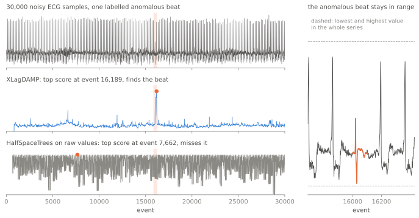

<p align="center">
  <a href="https://oliverhennhoefer.github.io/aberrant/">
    
  </a>
</p>

<h3 align="center">Real-time anomaly detection for data streams.</h3>

<p align="center">
  <a href="https://pypi.org/project/aberrant/"></a>
  <a href="https://pypi.org/project/aberrant/"></a>
  <a href="https://github.com/OliverHennhoefer/aberrant/actions/workflows/ci.yml"></a>
  <a href="https://codecov.io/gh/OliverHennhoefer/aberrant"></a>
  <a href="https://scorecard.dev/viewer/?uri=github.com/OliverHennhoefer/aberrant"></a>
  <a href="https://oliverhennhoefer.github.io/aberrant/"></a>
  <a href="https://github.com/OliverHennhoefer/aberrant/blob/main/LICENSE"></a>
</p>

<p align="center">
  <a href="https://oliverhennhoefer.github.io/aberrant/"><b>Documentation</b></a> ·
  <a href="https://oliverhennhoefer.github.io/aberrant/quickstart/">Quickstart</a> ·
  <a href="https://oliverhennhoefer.github.io/aberrant/user_guide/models/">Model guide</a> ·
  <a href="https://oliverhennhoefer.github.io/aberrant/user_guide/evaluation/">Evaluation</a> ·
  <a href="https://oliverhennhoefer.github.io/aberrant/api/">API reference</a> ·
  <a href="https://github.com/OliverHennhoefer/aberrant/blob/main/CHANGELOG.md">Changelog</a>
</p>

<p align="center">
  <b>Running it in production?</b>
  The <a href="https://oliverhennhoefer.github.io/aberrant/user_guide/integrations/">integration guide</a>
  shows how to build detectors from configurations.
</p>

## Quickstart

```python
from aberrant.model.iforest import HalfSpaceTrees
from aberrant.stream.dataset import Dataset, load
from aberrant.transform import MinMaxScaler, RollingRobustScaler

detector = (
    RollingRobustScaler(window_size=100)  # rolling median/IQR, robust to outliers
    | MinMaxScaler()  # map features to [0, 1] for the trees
    | HalfSpaceTrees(seed=42)
)

for event, label in load(Dataset.SHUTTLE).stream():
    score = detector.score_one(event)  # score first: higher means more anomalous
    detector.learn_one(event)  # then learn from the event
```

## Why aberrant

- **Broad toolbox.** Forest, density, sketch, graph, matrix-profile, SVM and autoencoder detectors.
- **Score to alert.** Drift detectors and adaptive thresholds turn scores into decisions.
- **Built for services.** `|` pipelines, bounded state, detectors built from plain configuration.
- **Measured on the stream.** Prequential evaluation, benchmark streams, separate timings.
- **Typed and extensible.** Ships `py.typed` and any protocol-conforming object joins a pipeline.

|                                                 | aberrant | river | PySAD |
| ----------------------------------------------- | :------: | :---: | :---: |
| Isolation forests and half-space trees          | ✓        | ✓     | ✓     |
| Projection sketches (LODA, RS-Hash)             | ✓        | ✓     | ✓     |
| Graph-edge streams (MIDAS, AnoEdge, ISCONNA)    | ✓        |       |       |
| Time-series discords (matrix profile, DAMP)     | ✓        |       |       |
| Drift detectors (ADWIN, KSWIN, Page-Hinkley)    | ✓        | ✓     |       |
| Score thresholds or calibration                 | ✓        | ✓     | ✓     |
| Detectors built from declarative configuration  | ✓        |       |       |
| General online ML (classification, regression)  |          | ✓     |       |

### Non-trivial detection

Many anomalies have no outlying value at all. In this ECG from the UCR Time
Series Anomaly Archive, one malformed heartbeat sits among roughly 180 normal
ones, under sensor noise and baseline wander, and every one of its values lies
inside the normal range. `XLagDAMP`, a matrix-profile discord detector, scores
the stream in a single pass from the first sample, with no training split and
bounded memory, and its highest score lands on that beat. Because the beat
differs in shape rather than in value, a detector that scores single values has
no outlier to find.

<p align="center">
  <picture>
    <source media="(prefers-color-scheme: dark)" srcset="https://raw.githubusercontent.com/OliverHennhoefer/aberrant/main/docs/img/discord-dark.svg">
    
  </picture>
</p>

<p align="center"><sub>Series <code>013_UCR_Anomaly_DISTORTEDECG3</code> (Wu and Keogh, 2021), with <code>XLagDAMP(subsequence_length=167)</code>. Reproduce with <a href="https://github.com/OliverHennhoefer/aberrant/blob/main/docs/scripts/discord_figure.py"><code>docs/scripts/discord_figure.py</code></a>.</sub></p>

---

## Installation

`aberrant` requires Python 3.11 or newer and is continuously tested on CPython
3.11 to 3.14 on Linux and Windows.

```bash
pip install aberrant
```

<details>
<summary><strong>Optional extras</strong></summary>

| Extra | Adds |
| --- | --- |
| `eval` | scikit-learn metrics for model evaluation |
| `dl` | the PyTorch-backed `Autoencoder` |
| `faiss` | the FAISS similarity-search engine used by models such as `KNN` |
| `benchmark` | River and pytest-benchmark |
| `docs` | the documentation build toolchain |
| `dev` | linting, typing, testing, and development dependencies |
| `all` | all optional and development dependencies |

For example:

```bash
pip install "aberrant[eval,faiss]"
```

</details>

## Choose a starting point

| Goal | Start with |
| --- | --- |
| General multivariate detection | [`OnlineIsolationForest` or another isolation-forest variant](https://oliverhennhoefer.github.io/aberrant/user_guide/models/#isolation-forests) |
| Local-neighborhood or density anomalies | [`LocalOutlierFactor`, `KNN`, `SDOStream`, or a cell-based detector](https://oliverhennhoefer.github.io/aberrant/user_guide/models/#distance-and-neighborhood-detectors) |
| Compact projection or frequency sketches | [`StreamingLODA`, `MStream`, or `StreamingRSHash`](https://oliverhennhoefer.github.io/aberrant/user_guide/models/#sketch-detectors) |
| Anomalous edges and graph evolution | [`AnoEdgeL`, `ISCONNA`, `MIDAS`, or `SignedGraphSketchDetector`](https://oliverhennhoefer.github.io/aberrant/user_guide/models/#graph-stream-detectors) |
| Discords in a scalar time series | [`RollingMatrixProfile` or `XLagDAMP`](https://oliverhennhoefer.github.io/aberrant/user_guide/models/#time-series-discord-detection) |
| Departures from a known seasonal forecast | [`SeasonalResidualDetector`](https://oliverhennhoefer.github.io/aberrant/user_guide/models/#seasonal-forecast-residuals) |
| Changes in relationships between time-series channels | [`MultivariateRollingMatrixProfile`](https://oliverhennhoefer.github.io/aberrant/user_guide/models/#time-series-discord-detection) |
| Interpretable rolling statistics | [Univariate and multivariate moving statistics](https://oliverhennhoefer.github.io/aberrant/user_guide/models/#statistical-detectors) |
| Adaptive margin-based detection | [Online SVM models](https://oliverhennhoefer.github.io/aberrant/user_guide/models/#svm-detectors) |
| Learned reconstruction error | [`OnlineAutoencoderEnsemble` or the optional PyTorch `Autoencoder`](https://oliverhennhoefer.github.io/aberrant/user_guide/models/#reconstruction-detectors) |
| Detecting distribution drift | [`ADWIN`, `KSWIN`, or `PageHinkley`](https://oliverhennhoefer.github.io/aberrant/api/drift/) |
| Turning a score into an alert signal | [`QuantileThreshold` or `ThresholdModel`](https://oliverhennhoefer.github.io/aberrant/user_guide/models/#core-utility-models) |

See the [model guide](https://oliverhennhoefer.github.io/aberrant/user_guide/models/)
for inputs, score interpretation, warm-up behavior, and memory characteristics.

<details>
<summary><strong>Included public model families</strong></summary>

| Family | Implementations |
| --- | --- |
| Isolation forest | `ASDIsolationForest`, `HalfSpaceTrees`, `MondrianIsolationForest`, `OnlineIsolationForest`, `RandomCutForest`, `StreamRandomHistogramForest`, `XStream` |
| Distance | `CellNeighborhoodDetector`, `KNN`, `LocalOutlierFactor`, `SDOStream`, `StationaryRegionNeighborDetector` |
| Sketch | `MStream`, `StreamingLODA`, `StreamingRSHash` |
| Graph | `AnoEdgeL`, `ISCONNA`, `MIDAS`, `SignedGraphSketchDetector` |
| Time series | `MultivariateRollingMatrixProfile`, `RollingMatrixProfile`, `SeasonalResidualDetector`, `XLagDAMP` |
| SVM | `GraphGatedOneClassSVM`, `IncrementalOneClassSVMAdaptiveKernel` |
| Statistical | `MovingAverage`, `MovingAverageAbsoluteDeviation`, `MovingGeometricAverage`, `MovingHarmonicAverage`, `MovingInterquartileRange`, `MovingKurtosis`, `MovingMedian`, `MovingQuantile`, `MovingSkewness`, `MovingVariance`, `MovingCorrelationCoefficient`, `MovingCovariance`, `MovingMahalanobisDistance` |
| Reconstruction | `OnlineAutoencoderEnsemble`, optional `Autoencoder` |
| Score policy | `QuantileThreshold`, `ThresholdModel` |
| Baselines | `NullModel`, `RandomModel` |
| Drift detection | `ADWIN`, `KSWIN`, `PageHinkley` |

</details>

## Pipelines and custom components

Transformers compose left to right, with at most one terminal model:

```python
from aberrant.model.iforest import OnlineIsolationForest
from aberrant.transform import IncrementalPCA, StandardScaler

detector = (
    StandardScaler()
    | IncrementalPCA(n_components=3, n0=100)
    | OnlineIsolationForest(window_size=512, seed=42)
)
```

Read the
[pipeline guide](https://oliverhennhoefer.github.io/aberrant/user_guide/pipelines/)
for lifecycle and composition rules.

---

<p align="center">
  <a href="https://www.dlr.de/">
    
  </a>
</p>
