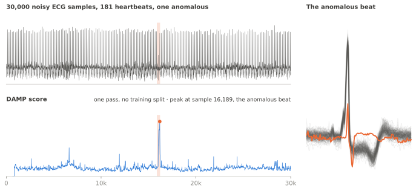

<p align="center">
  <a href="https://oliverhennhoefer.github.io/aberrant/">
    <picture>
      <source media="(prefers-color-scheme: dark)" srcset="https://raw.githubusercontent.com/OliverHennhoefer/aberrant/main/docs/img/logo-dark.svg">
      
    </picture>
  </a>
</p>

<h3 align="center">Real-time anomaly detection for data streams.</h3>

<p align="center">
  <a href="https://pypi.org/project/aberrant/"></a>
  <a href="https://pypi.org/project/aberrant/"></a>
  <a href="https://github.com/OliverHennhoefer/aberrant/actions/workflows/ci.yml"></a>
  <a href="https://codecov.io/gh/OliverHennhoefer/aberrant"></a>
  <a href="https://oliverhennhoefer.github.io/aberrant/"></a>
  <a href="https://github.com/OliverHennhoefer/aberrant/blob/main/LICENSE"></a>
</p>

<p align="center">
  <a href="https://oliverhennhoefer.github.io/aberrant/"><b>Documentation</b></a> ·
  <a href="https://oliverhennhoefer.github.io/aberrant/quickstart/">Quickstart</a> ·
  <a href="https://oliverhennhoefer.github.io/aberrant/user_guide/models/">Model guide</a> ·
  <a href="https://oliverhennhoefer.github.io/aberrant/user_guide/evaluation/">Evaluation</a> ·
  <a href="https://oliverhennhoefer.github.io/aberrant/api/">API reference</a> ·
  <a href="https://github.com/OliverHennhoefer/aberrant/blob/main/CHANGELOG.md">Changelog</a>
</p>

---

**A stream has no training set, and what counts as normal keeps changing.**
aberrant's detectors have no `fit` step. Each one scores an event against what
it has learned so far, then learns from it. The steps around the detector work
the same way, one event at a time: preprocessing, alarm thresholds that adapt
with the scores, drift detection and evaluation. The base install depends on
NumPy alone.

Not every anomaly is an outlying value. In this ECG, one of 181 heartbeats has
the wrong shape, yet every one of its samples lies inside the normal range.
`DAMP` scores the series in a single pass, with no training split and in
bounded memory, and its highest score lands on that beat.

<p align="center">
  <picture>
    <source media="(prefers-color-scheme: dark)" srcset="https://raw.githubusercontent.com/OliverHennhoefer/aberrant/main/docs/img/discord-dark.svg">
    
  </picture>
</p>

<p align="center"><sub>Series <code>013_UCR_Anomaly_DISTORTEDECG3</code> (Wu and Keogh, 2021), with <code>DAMP(subsequence_length=167)</code>. Reproduce with <a href="https://github.com/OliverHennhoefer/aberrant/blob/main/docs/scripts/discord_figure.py"><code>docs/scripts/discord_figure.py</code></a>.</sub></p>

## Installation

aberrant requires Python 3.12 or newer and is tested on CPython 3.12 to 3.14,
on Linux and Windows.

```bash
pip install aberrant
```

<details>
<summary><strong>Optional extras</strong></summary>

| Extra | Adds |
| --- | --- |
| `eval` | scikit-learn metrics for model evaluation |
| `dl` | the PyTorch-backed `Autoencoder` |
| `faiss` | the FAISS backend of `KNN` (`backend="faiss"`) |
| `all` | `eval`, `dl` and `faiss` together |

For example:

```bash
pip install "aberrant[eval,faiss]"
```

</details>

## Quick start

Every detector implements the same two methods. `score_one(event)` returns an
anomaly score without learning the event, and `learn_one(event)` updates the
model. An event is a `dict[str, float]`, and a higher score means more unusual.

The loop below replays the Shuttle benchmark, 49,097 events of which 7% are
labelled anomalies, and flags an event when its score exceeds a threshold that
adapts online:

```python
from aberrant.calibration import ScoreCalibrator
from aberrant.datasets import Dataset, load
from aberrant.model.forest import OnlineIsolationForest

detector = OnlineIsolationForest(seed=42)
threshold = ScoreCalibrator("aci", alpha=0.05, window_size=1_000)

flagged = []
for t, (event, label) in enumerate(load(Dataset.SHUTTLE)):
    score = detector.score_one(event)  # rated against earlier events only
    if detector.readiness.ready:  # scores are 0.0 until warm-up is over
        if score > threshold.predict(t):
            flagged.append(label)
        threshold.update(t, score)
    detector.learn_one(event)  # then learn the event

print(f"Flagged {len(flagged):,} events, {sum(flagged):,} of them labelled anomalies")
# Flagged 2,452 events, 2,328 of them labelled anomalies
```

The labels only count the outcome; the detector never sees them. `"aci"` is
adaptive conformal inference, one of 17 online
[threshold methods](https://oliverhennhoefer.github.io/aberrant/user_guide/calibration/).
At `alpha=0.05` it lets about 5% of scores through, fewer than the 7% of events
that are anomalous, and 95% of what it flags is a labelled anomaly.

### Measure a detector

`PrequentialEvaluator` runs the same score-then-learn loop and reports ranking
metrics, which need `pip install "aberrant[eval]"`. `metric_window_size=None`
ranks the whole stream instead of the last 1,000 labelled events.

```python
from aberrant.datasets import Dataset, load
from aberrant.evaluate import PrequentialEvaluator
from aberrant.model.forest import OnlineIsolationForest

evaluator = PrequentialEvaluator(
    OnlineIsolationForest(seed=42), metrics=True, metric_window_size=None
)
result = evaluator.evaluate(load(Dataset.SHUTTLE))
print(f"ROC AUC {result.roc_auc:.3f}, average precision {result.average_precision:.3f}")
# ROC AUC 0.990, average precision 0.969
```

### Other kinds of streams

The same loop runs on other kinds of events. Only the detector changes:

```python
from aberrant.forecast import HoltWinters, ResidualDetector
from aberrant.model.forest import HalfSpaceTrees
from aberrant.model.graph import MIDAS
from aberrant.model.timeseries import DAMP
from aberrant.transform import Imputer, MinMaxScaler

# {"load": 41.7}: how far a reading misses its seasonal forecast
detector = ResidualDetector(HoltWinters(season_length=24), target="load")

# {"ecg": 0.31}: a stretch of one series unlike anything before it
detector = DAMP(subsequence_length=167)

# {"src": 12, "dst": 7, "t": 3}: a burst of edges between two nodes
detector = MIDAS(source_key="src", destination_key="dst", time_key="t")

# {"cpu": 0.42, "latency_ms": None}: fill the gap and rescale, then score
detector = Imputer() | MinMaxScaler() | HalfSpaceTrees(seed=42)
```

Coming from river or PySAD? The
[migration guide](https://oliverhennhoefer.github.io/aberrant/user_guide/migrating/)
maps their loops and components to aberrant.

## What is included

| Detector family | Implementations |
| --- | --- |
| [Isolation forests](https://oliverhennhoefer.github.io/aberrant/user_guide/models/#isolation-forests) | `OnlineIsolationForest`, `HalfSpaceTrees`, `RandomCutForest`, `ASDIsolationForest`, `MondrianIsolationForest`, `RHF`, `XStream` |
| [Distance and density](https://oliverhennhoefer.github.io/aberrant/user_guide/models/#distance-and-neighborhood-detectors) | `KNN`, `LocalOutlierFactor`, `SDOStream`, `CellNeighborhoodDetector` |
| [Sketches](https://oliverhennhoefer.github.io/aberrant/user_guide/models/#sketch-detectors) | `LODA`, `RSHash`, `MStream` |
| [Graph streams](https://oliverhennhoefer.github.io/aberrant/user_guide/models/#graph-stream-detectors) | `MIDAS`, `ISCONNA`, `AnoEdgeL`, `StreamSpot` |
| [Time-series discords](https://oliverhennhoefer.github.io/aberrant/user_guide/models/#time-series-discord-detection) | `DAMP`, `RollingMatrixProfile`, `MultivariateRollingMatrixProfile` |
| [Statistics](https://oliverhennhoefer.github.io/aberrant/user_guide/models/#statistical-detectors) | `MovingZScore`, `MovingMAD`, `MovingMahalanobisDistance`, `MovingCovariance`, `MovingCorrelationCoefficient`, `OnlineECOD`, `OnlineCOPOD` |
| [Forecast residuals](https://oliverhennhoefer.github.io/aberrant/user_guide/forecasting/) | `ResidualDetector` over `SeasonalNaive`, `HoltWinters`, `KalmanForecaster`, `AutoRegressive`, `LagForecaster`, `EchoStateForecaster`, `EnsembleForecaster` or one of seven online regressors |
| [Reconstruction](https://oliverhennhoefer.github.io/aberrant/user_guide/models/#reconstruction-detectors) | `OnlineAutoencoderEnsemble`, `Autoencoder` (PyTorch) |
| [SVM](https://oliverhennhoefer.github.io/aberrant/user_guide/models/#svm-detectors) | `AdaptiveOneClassSVM` (experimental) |
| [Ensemble](https://oliverhennhoefer.github.io/aberrant/user_guide/models/#combining-detectors) | `ScoreEnsemble` puts its members' scores on one scale and combines them |
| [Rules and baselines](https://oliverhennhoefer.github.io/aberrant/user_guide/models/#core-utility-models) | `ThresholdModel`, `NullModel`, `RandomModel` |

`OnlineIsolationForest` is the general-purpose start for multivariate events.
The [model guide](https://oliverhennhoefer.github.io/aberrant/user_guide/models/)
compares every detector's input, score range, warm-up and memory. `OnlineECOD`,
`OnlineCOPOD`, `LODA`, `MovingMahalanobisDistance` and `HalfSpaceTrees` also
split a score among the event's features with
[`attribute_one`](https://oliverhennhoefer.github.io/aberrant/user_guide/models/#which-feature-made-an-event-unusual).

| Around&nbsp;the&nbsp;detector | Components |
| --- | --- |
| [Transformers](https://oliverhennhoefer.github.io/aberrant/user_guide/transformers/) | `Imputer`, `OneHotEncoder`, `FrequencyEncoder`, `StandardScaler`, `RollingRobustScaler`, `Lags`, `Difference`, `RollingStatistic`, `Deseasonalize`, `IncrementalPCA` and ten more |
| [Thresholds](https://oliverhennhoefer.github.io/aberrant/user_guide/calibration/) | `ScoreCalibrator` with 17 online methods, among them rolling split conformal, ACI, conformal PID and SPOT, all with delayed feedback |
| [Drift detection](https://oliverhennhoefer.github.io/aberrant/user_guide/drift/) | `ADWIN`, `CUSUM`, `KSWIN`, `PageHinkley` |
| [Evaluation](https://oliverhennhoefer.github.io/aberrant/user_guide/evaluation/) | `PrequentialEvaluator` for detectors, `ForecastEvaluator` for forecasters, `vus` for range-aware VUS-ROC and VUS-PR |
| [Datasets](https://oliverhennhoefer.github.io/aberrant/user_guide/datasets/) | 25 labelled benchmarks, verified by SHA-256 before they are read, and `synthetic` streams with injected anomalies |

A component of your own joins a
[pipeline](https://oliverhennhoefer.github.io/aberrant/user_guide/pipelines/#custom-structural-components)
without a base class: it needs `readiness`, `learn_one` and either `score_one`
or `transform_one`.
[`GraphPipeline`](https://oliverhennhoefer.github.io/aberrant/user_guide/graph_pipelines/)
handles branches that merge.

## In production

A service usually builds its detectors from stored configuration.
[`DetectorConfig`](https://oliverhennhoefer.github.io/aberrant/user_guide/integrations/)
takes a plain mapping, accepts only catalog identifiers, never import paths,
and reports each invalid field with its location:

```python
from aberrant.catalog import DetectorConfig

config = DetectorConfig.from_mapping(
    {
        "transformers": [{"id": "standard_scaler"}],
        "model": {"id": "online_isolation_forest", "params": {"seed": 42}},
    }
)
detector = config.build()  # StandardScaler | OnlineIsolationForest
config.capabilities().warm_up  # 33 events before the model scores
config.fingerprint()  # SHA-256 of the configuration, defaults filled in
```

- Detector state is bounded by a window, sketch or budget set in the
  constructor. The catalog flags the two exceptions: `MondrianIsolationForest`
  grows unless given a `window_size`, and the PyTorch `Autoencoder` holds
  whatever its network and optimizer hold.
- Every component reports `readiness`: whether it has learned enough to score,
  and how far along it is.
- A malformed event raises `ValidationError` and can go to a dead-letter queue.
  When a pipeline stage rejects an event, the built-in transformers before it
  restore their state.
- A pickle carries the learned state and the aberrant version that wrote it,
  and loads only in that version. See
  [best practices](https://oliverhennhoefer.github.io/aberrant/user_guide/best_practices/)
  for checkpoints, concurrency and long-running streams.
- The public API follows semantic versioning. Import paths, parameters, catalog
  identifiers and the configuration format stay compatible within 2.x.
- The package ships `py.typed` and passes mypy. CI checks every tabular
  detector's ROC AUC and average precision on Shuttle against a floor and
  replays recorded score sequences, so a speed-up cannot change scores
  unnoticed.

## Scope

aberrant is unsupervised. A high score says an event is unusual, not that it
is a fault. Scores rank events and are not probabilities, and their range
differs by detector, so a threshold does not carry over from one detector to
another. A `ScoreCalibrator` targets how often scores exceed its threshold,
which is a false-alarm rate only on a stream of normal data; the
[calibration guide](https://oliverhennhoefer.github.io/aberrant/user_guide/calibration/#methods)
lists which methods come with a guarantee. A detector instance is not
thread-safe, and state learned on separate partitions cannot be merged.

## Project

Read the [documentation](https://oliverhennhoefer.github.io/aberrant/), browse
the [changelog](https://github.com/OliverHennhoefer/aberrant/blob/main/CHANGELOG.md),
or report a problem in the [issue tracker](https://github.com/OliverHennhoefer/aberrant/issues).
Contributions are welcome; start with the
[contributing guide](https://oliverhennhoefer.github.io/aberrant/contributing/).
To cite aberrant, use
[`CITATION.cff`](https://github.com/OliverHennhoefer/aberrant/blob/main/CITATION.cff).
aberrant is distributed under the
[MIT License](https://github.com/OliverHennhoefer/aberrant/blob/main/LICENSE).

<p align="center">
  <a href="https://www.dlr.de/">
    
  </a>
</p>
