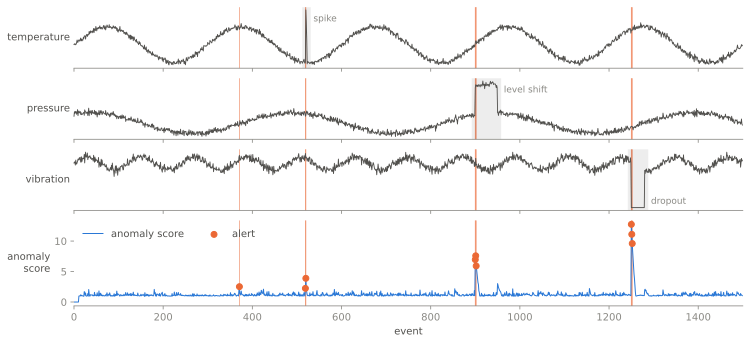

<p align="center">
  <a href="https://oliverhennhoefer.github.io/aberrant/">
    
  </a>
</p>

<h3 align="center">Real-time anomaly detection for data streams in Python.</h3>

<p align="center">
  Score every event as it arrives and adapt as the data changes.<br>
  Forests, sketches, graph and time-series detectors that learn as the data arrives.
</p>

<p align="center">
  <a href="https://pypi.org/project/aberrant/"></a>
  <a href="https://pypi.org/project/aberrant/"></a>
  <a href="https://github.com/OliverHennhoefer/aberrant/actions/workflows/ci.yml"></a>
  <a href="https://codecov.io/gh/OliverHennhoefer/aberrant"></a>
  <a href="https://scorecard.dev/viewer/?uri=github.com/OliverHennhoefer/aberrant"></a>
  <a href="https://oliverhennhoefer.github.io/aberrant/"></a>
  <a href="https://github.com/OliverHennhoefer/aberrant/blob/main/LICENSE"></a>
</p>

<p align="center">
  <a href="https://oliverhennhoefer.github.io/aberrant/"><b>Documentation</b></a> ·
  <a href="https://oliverhennhoefer.github.io/aberrant/quickstart/">Quickstart</a> ·
  <a href="https://oliverhennhoefer.github.io/aberrant/user_guide/models/">Model guide</a> ·
  <a href="https://oliverhennhoefer.github.io/aberrant/user_guide/evaluation/">Evaluation</a> ·
  <a href="https://oliverhennhoefer.github.io/aberrant/api/">API reference</a> ·
  <a href="https://github.com/OliverHennhoefer/aberrant/blob/main/CHANGELOG.md">Changelog</a>
</p>

<p align="center">
  <picture>
    <source media="(prefers-color-scheme: dark)" srcset="https://raw.githubusercontent.com/OliverHennhoefer/aberrant/main/docs/img/stream-dark.svg">
    
  </picture>
</p>

<p align="center"><sub>A scaled <code>LocalOutlierFactor</code> scores each event before learning it; an online <code>QuantileThreshold</code> raises the alerts. Reproduce it with <a href="https://github.com/OliverHennhoefer/aberrant/blob/main/docs/scripts/stream_figure.py"><code>docs/scripts/stream_figure.py</code></a>.</sub></p>

## Quickstart

```bash
pip install aberrant
```

```python
from aberrant.model.iforest import HalfSpaceTrees
from aberrant.stream.dataset import Dataset, load
from aberrant.transform import MinMaxScaler

detector = MinMaxScaler() | HalfSpaceTrees(seed=42)

for event, label in load(Dataset.SHUTTLE).stream():
    detector.learn_one(event)
    score = detector.score_one(event)  # higher means more anomalous
```

The detector sees each of the 49,096 Shuttle events once, keeps a bounded
window of state, and needs no training set or retraining job. The loop runs
in under 10 seconds on one CPU core and reaches a ROC-AUC of about 0.97. The
dataset is downloaded and cached on first use.

## Why aberrant

- **A broad streaming toolbox.** Isolation forests and half-space trees,
  density and distance methods, projection sketches, graph-edge detectors
  (MIDAS, AnoEdge), matrix-profile discords, online SVMs and autoencoders all
  follow the same event-by-event contract.
- **From score to alert.** Drift detectors (ADWIN, KSWIN, Page-Hinkley) and
  static or adaptive thresholds turn raw scores into decisions.
- **Built for services.** Compose online preprocessing with `|`, keep state
  bounded with sliding windows, sketches or fading summaries, and build
  detectors from plain configuration through a typed catalog.
- **Measured on the stream.** A prequential evaluator, registered benchmark
  streams, explicit warm-up, and separate timings for scoring and updating.
- **Typed and extensible.** Ships `py.typed`; any object that satisfies the
  structural model or transformer protocol can join a pipeline.

## aberrant, river or PySAD?

|                                                 | aberrant | river | PySAD |
| ----------------------------------------------- | :------: | :---: | :---: |
| Isolation forests and half-space trees          | ✓        | ✓     | ✓     |
| Projection sketches (LODA, RS-Hash)             | ✓        | ✓     | ✓     |
| Graph-edge streams (MIDAS, AnoEdge, ISCONNA)    | ✓        |       |       |
| Time-series discords (matrix profile, DAMP)     | ✓        |       |       |
| Drift detectors (ADWIN, KSWIN, Page-Hinkley)    | ✓        | ✓     |       |
| Score thresholds or calibration                 | ✓        | ✓     | ✓     |
| Detectors built from declarative configuration  | ✓        |       |       |
| General online ML (classification, regression)  |          | ✓     |       |

Use river for general online learning. Use aberrant when anomalies are the
job. aberrant uses river's `learn_one` / `score_one` convention, so moving
between the two is straightforward. Compared with river 0.26 and PySAD 0.7.

## Installation

`aberrant` requires Python 3.11 or newer and is continuously tested on CPython
3.11 to 3.14 on Linux and Windows.

```bash
pip install aberrant
```

<details>
<summary><strong>Optional extras</strong></summary>

| Extra | Adds |
| --- | --- |
| `eval` | scikit-learn metrics for model evaluation |
| `dl` | the PyTorch-backed `Autoencoder` |
| `faiss` | the FAISS similarity-search engine used by models such as `KNN` |
| `benchmark` | River and pytest-benchmark |
| `docs` | the documentation build toolchain |
| `dev` | linting, typing, testing, and development dependencies |
| `all` | all optional and development dependencies |

For example:

```bash
pip install "aberrant[eval,faiss]"
```

</details>

## Choose a starting point

| Goal | Start with |
| --- | --- |
| General multivariate detection | [`OnlineIsolationForest` or another isolation-forest variant](https://oliverhennhoefer.github.io/aberrant/user_guide/models/#isolation-forests) |
| Local-neighborhood or density anomalies | [`LocalOutlierFactor`, `KNN`, `SDOStream`, or a cell-based detector](https://oliverhennhoefer.github.io/aberrant/user_guide/models/#distance-and-neighborhood-detectors) |
| Compact projection or frequency sketches | [`StreamingLODA`, `MStream`, or `StreamingRSHash`](https://oliverhennhoefer.github.io/aberrant/user_guide/models/#sketch-detectors) |
| Anomalous edges and graph evolution | [`AnoEdgeL`, `ISCONNA`, `MIDAS`, or `SignedGraphSketchDetector`](https://oliverhennhoefer.github.io/aberrant/user_guide/models/#graph-stream-detectors) |
| Discords in a scalar time series | [`RollingMatrixProfile` or `XLagDAMP`](https://oliverhennhoefer.github.io/aberrant/user_guide/models/#time-series-discord-detection) |
| Departures from a known seasonal forecast | [`SeasonalResidualDetector`](https://oliverhennhoefer.github.io/aberrant/user_guide/models/#seasonal-forecast-residuals) |
| Changes in relationships between time-series channels | [`MultivariateRollingMatrixProfile`](https://oliverhennhoefer.github.io/aberrant/user_guide/models/#time-series-discord-detection) |
| Interpretable rolling statistics | [Univariate and multivariate moving statistics](https://oliverhennhoefer.github.io/aberrant/user_guide/models/#statistical-detectors) |
| Adaptive margin-based detection | [Online SVM models](https://oliverhennhoefer.github.io/aberrant/user_guide/models/#svm-detectors) |
| Learned reconstruction error | [`OnlineAutoencoderEnsemble` or the optional PyTorch `Autoencoder`](https://oliverhennhoefer.github.io/aberrant/user_guide/models/#reconstruction-detectors) |
| Detecting distribution drift | [`ADWIN`, `KSWIN`, or `PageHinkley`](https://oliverhennhoefer.github.io/aberrant/api/drift/) |
| Turning a score into an alert signal | [`QuantileThreshold` or `ThresholdModel`](https://oliverhennhoefer.github.io/aberrant/user_guide/models/#core-utility-models) |

See the [model guide](https://oliverhennhoefer.github.io/aberrant/user_guide/models/)
for inputs, score interpretation, warm-up behavior, and memory characteristics.

<details>
<summary><strong>Included public model families</strong></summary>

| Family | Implementations |
| --- | --- |
| Isolation forest | `ASDIsolationForest`, `HalfSpaceTrees`, `MondrianIsolationForest`, `OnlineIsolationForest`, `RandomCutForest`, `StreamRandomHistogramForest`, `XStream` |
| Distance | `CellNeighborhoodDetector`, `KNN`, `LocalOutlierFactor`, `SDOStream`, `StationaryRegionNeighborDetector` |
| Sketch | `MStream`, `StreamingLODA`, `StreamingRSHash` |
| Graph | `AnoEdgeL`, `ISCONNA`, `MIDAS`, `SignedGraphSketchDetector` |
| Time series | `MultivariateRollingMatrixProfile`, `RollingMatrixProfile`, `SeasonalResidualDetector`, `XLagDAMP` |
| SVM | `GraphGatedOneClassSVM`, `IncrementalOneClassSVMAdaptiveKernel` |
| Statistical | `MovingAverage`, `MovingAverageAbsoluteDeviation`, `MovingGeometricAverage`, `MovingHarmonicAverage`, `MovingInterquartileRange`, `MovingKurtosis`, `MovingMedian`, `MovingQuantile`, `MovingSkewness`, `MovingVariance`, `MovingCorrelationCoefficient`, `MovingCovariance`, `MovingMahalanobisDistance` |
| Reconstruction | `OnlineAutoencoderEnsemble`, optional `Autoencoder` |
| Score policy | `QuantileThreshold`, `ThresholdModel` |
| Baselines | `NullModel`, `RandomModel` |
| Drift detection | `ADWIN`, `KSWIN`, `PageHinkley` |

</details>

## Pipelines and custom components

Transformers compose left to right, with at most one terminal model:

```python
from aberrant.model.iforest import OnlineIsolationForest
from aberrant.transform import IncrementalPCA, StandardScaler

detector = (
    StandardScaler()
    | IncrementalPCA(n_components=3, n0=100)
    | OnlineIsolationForest(window_size=512, seed=42)
)
```

Any custom object satisfying `TransformerProtocol` or `ModelProtocol` can join
a pipeline; subclassing an `aberrant` base class is optional. Read the
[pipeline guide](https://oliverhennhoefer.github.io/aberrant/user_guide/pipelines/)
for lifecycle and composition rules.

## Application integration

`RollingRobustScaler` adds exact median/IQR scaling over bounded recent
feature windows. Its `freeze()` and `unfreeze()` controls make calibration
updates explicit; see the [transformer guide](https://oliverhennhoefer.github.io/aberrant/user_guide/transformers/)
for readiness, zero-IQR behavior, and downstream coordinate considerations.

The built-in catalog makes model facts and construction available to services,
configuration UIs, and deployment tooling without duplicating import paths or
warm-up formulas:

```python
from aberrant.catalog import DetectorConfig, get_model_spec

spec = get_model_spec("online_isolation_forest")
print(spec.parameter_schema())

config = DetectorConfig.from_mapping(
    {
        "transformers": [
            {
                "id": "feature_schema_guard",
                "params": {"features": ["temperature", "pressure"]},
            },
            {"id": "standard_scaler"},
        ],
        "model": {
            "id": "online_isolation_forest",
            "params": {"window_size": 512, "seed": 42},
        },
    }
)
detector = config.build()
```

See the [application integration guide](https://oliverhennhoefer.github.io/aberrant/user_guide/integrations/)
for the catalog manifest, capability fields, KNN/FAISS configuration, and the
boundary between package metadata and application policy.

## Streaming datasets

The dataset API downloads, validates, and caches registered benchmark data,
then exposes it as feature dictionaries and evaluation labels:

```python
from itertools import islice

from aberrant.model.iforest import OnlineIsolationForest
from aberrant.stream.dataset import Dataset, load

dataset = load(Dataset.SHUTTLE)
detector = OnlineIsolationForest(num_trees=25, window_size=512, seed=42)

for event, label in islice(dataset.stream(), 100):
    score = detector.score_one(event)
    detector.learn_one(event)
    print(f"label={label!r}, anomaly_score={score:.3f}")
```

Labels are provided for evaluation; unsupervised detectors learn only from the
event mapping. Cache location and download behavior are configurable through
the [streaming guide](https://oliverhennhoefer.github.io/aberrant/user_guide/streaming/).

## Related projects

- [nonconform](https://github.com/OliverHennhoefer/nonconform) calibrates
  anomaly scores into conformal p-values and monitors streams for change.
- [online-fdr](https://github.com/OliverHennhoefer/online-fdr) controls the
  false discovery rate when alerts are raised one test at a time.
- [Aberration](https://github.com/DataDrivenSustainabilitySolutions/off-key)
  is an open-source platform that runs aberrant pipelines on live MQTT
  telemetry and lets people review the evidence.

## Contributing

Bug reports, detector requests and pull requests are welcome. Start with the
[contributing guide](https://github.com/OliverHennhoefer/aberrant/blob/main/CONTRIBUTING.md).
`aberrant` is released under the [MIT license](https://github.com/OliverHennhoefer/aberrant/blob/main/LICENSE).

---

<p align="center">
  <a href="https://www.dlr.de/">
    
  </a>
</p>
